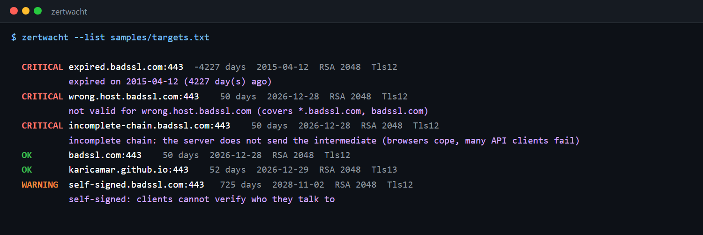

# Zertwacht

**A TLS certificate monitor for your own servers and certificate files. It warns before a certificate expires, and finds the problems that
break clients even while a browser still shows the padlock: missing intermediate certificates, hostname mismatches, SHA-1 signatures, weak keys,
self-signed certificates and lifetimes longer than CAs may issue.**



> 🇩🇪 **Kurzbeschreibung:** Zertwacht überwacht TLS-Zertifikate eigener Server und Zertifikatsdateien: Ablauf (Warnung 30, kritisch 7 Tage vorher),
> schwache Schlüssel, SHA-1-Signaturen, falscher Hostname, unvollständige Zertifikatskette, selbstsignierte Zertifikate und zu lange Laufzeiten.
> Abgelaufene Zertifikate gehören zu den häufigsten Ursachen für Ausfälle; Zertwacht meldet sie, bevor Kunden es merken.

## Why

Expired certificates take down payment APIs, mobile apps and internal services far more often than attacks do, usually because the one person
who renewed it last year has left. And "it works in my browser" is not proof: browsers fetch a missing intermediate certificate themselves and cache
it, while Java, .NET, Python and many API clients do not, so the integration partner sees an error you cannot reproduce. Zertwacht checks what the
server actually sends, not what your machine can fill in.

## Quick start

```bash
git clone https://github.com/karicamar/zertwacht && cd zertwacht
dotnet run --project src/Zertwacht.Cli -- --list samples/targets.txt
dotnet run --project src/Zertwacht.Cli -- api.mycompany.de:8443 certs/ --ca certs/internal-root.pem --format markdown -o report.md
```

```text
Usage: zertwacht <target> [<target> ...] [options]
  target   host, host:port, https://url, a .pem/.crt/.cer/.der file, or a folder of them

  --list <file>          targets, one per line (# for comments)
  --warn <days>          warning before expiry (default 30)
  --critical <days>      critical before expiry (default 7)
  --ca <file>            trust this internal root CA (repeatable)
  --no-trust             do not check the chain (internal certificates without their CA)
  -f, --format <console|markdown|json>
  -o, --output <file>
  --fail-on <critical|warning|none>   exit code 1 at this level (default: critical)
```

## Checks

| Code | Severity | What |
|---|---|---|
| `expired` / `expires-soon` | critical / warning | Past `NotAfter`, less than 7 days left, less than 30 days left (configurable) |
| `not-yet-valid` | critical | `NotBefore` in the future: a clock problem or a certificate deployed too early |
| `name-mismatch` | critical | The host is not in the Subject Alternative Names. Wildcards follow RFC 6125: `*.example.com` covers `a.example.com`, not `example.com` or `a.b.example.com` |
| `untrusted-chain` | critical | Does not chain to a trusted root, or the **server does not send the intermediate** (checked against the certificates the server actually sent, so a locally cached intermediate cannot hide it) |
| `weak-signature` | critical | SHA-1 or MD5 signature |
| `weak-key` | critical | RSA below 2048 bits, EC below 256 bits |
| `self-signed` | warning | A self-signed end-entity certificate: clients cannot verify the server |
| `no-san` | warning | No Subject Alternative Name: browsers ignore the CN since 2017 |
| `long-lifetime` | info | Valid longer than 398 days (CA/Browser Forum maximum for public certificates, shrinking further from 2026): renewal should be automated (ACME) |

Revocation (OCSP/CRL) is deliberately not checked: it needs network access to the CA and is a different question from "will this break".
Thumbprints are SHA-256, not the SHA-1 thumbprint Windows shows by default.

## Live endpoints, safely

Zertwacht connects, completes the TLS handshake with SNI, records the certificate, the chain the server sent and the negotiated protocol, and
closes the connection. It sends nothing after the handshake. The handshake accepts any certificate on purpose (otherwise an expired certificate
could not be reported); trust is decided afterwards by the analyzer. Up to 8 endpoints are checked in parallel, each with a 10-second timeout.
Use it for systems you run or are responsible for.

## In CI

The repository's own [workflow](.github/workflows/ci.yml) runs daily:

- **monitor-portfolio** checks my site `karicamar.github.io` with `--fail-on warning`, so I hear about it 30 days before it expires.
- **demo** checks the [badssl.com](https://badssl.com) test endpoints (servers with deliberately broken certificates, made for testing TLS clients)
  and fails unless each one gets exactly the expected finding: `expired`, `name-mismatch`, `self-signed`, `untrusted-chain` for the incomplete
  chain, and nothing for the correctly configured ones. I found the incomplete-chain case this way: the first version reported it as OK, because
  Windows had cached the intermediate.

Inside GitHub Actions the Markdown table also goes to the run's summary page.

## Tests

36 xUnit tests that need no network: they build real certificate hierarchies in memory (root CA → intermediate → leaf) and break them one way
at a time: expired, not yet valid, weak RSA key, SHA-1 signature (built with a custom signature generator, since .NET refuses to create one),
missing SAN, wrong host, self-signed, missing intermediate, unknown root. Plus PEM bundles, DER files, folders, target parsing (`host:port`, URLs,
IPv6) and the reports.

## License

MIT
